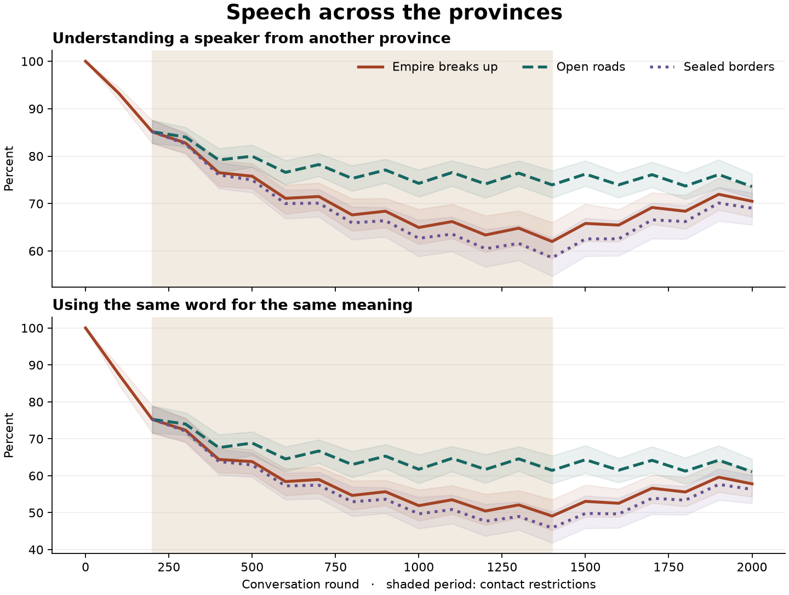

# Lingua Franca

A speaker in Tarraco coins *pulo* for water. The first listener doesn’t recognize
it. Fifty-nine rounds later another picks it up when the speaker points. That listener goes on to teach somebody else. By the time distant roads
reopen, speakers are passing around *pelo*, a descendant of the same word.

That happened in one of **256 artificial worlds**. Lingua Franca simulates how
dialects form as people talk, misunderstand one another, learn, and raise a new
cohort. Six provinces loosely mirror the western Roman world. Each world has
**3,072 individual speakers**. They keep personal vocabularies for 24 everyday
meanings and can recognize pronunciations they don’t use themselves.
[Follow the recorded exchanges](docs/results/provinces/water-lineages.csv)

## When the roads close

Every world runs for 200 rounds before it branches. The people, their contacts
so far, and everything they have learned are identical at the split. Each person
still has one turn as a listener every round. The difference is who they hear.

| History | From round 201 through 1,400 | After round 1,400 |
|---|---|---|
| Empire breaks up | 3% chance of a speaker from a neighboring province | Long-distance contact resumes |
| Open roads | 25% chance of a speaker from any other province | The same roads stay open |
| Sealed borders | Everyone hears local speakers only | Long-distance contact resumes |

Across **768 histories of 2,000 rounds**, the engine processed **4,404,019,200
simulated conversations**, counting the shared beginnings once. Speakers coined
1,102,026 words and adopted another person’s pronunciation 259,356,539 times.



At the end of fragmentation, a listener recognized a word from another province
**62.0%** of the time in the breakup worlds, **73.9%** with open roads, and
**58.6%** with sealed borders. The breakup worlds scored below their open-roads
twins in all 256 seeds. After 600 rounds of renewed contact, recognition in the
breakup worlds recovered to **70.5%**, versus **73.6%** in the open-roads twins.

These scores come from a separate listening test that samples every province
pair equally, including pairs that could never meet during isolation. Lines show
seed means and ribbons span the middle 80% of worlds. The model uses invented
words and synthetic contact rates. [Rules and measurement](simulation/README.md)
· [Results by seed](docs/results/provinces/intervals.csv.gz)
· [Summary](docs/results/provinces/summary.json)

## Follow one word

The engine gives every newly coined word a lineage ID. Sound changes can alter
the pronunciation while preserving that ID. Here are five encounters from
lineage `2636130` in the first breakup world. It was chosen because its spread is
particularly easy to follow.

| Round | What happened to the word for water |
|---:|---|
| 859 | Speaker 327 coined *pulo* in Tarraco. The listener didn’t recognize it. |
| 918 | Speaker 327 used it again. After a pointing gesture, listener 1597674 adopted it. |
| 985 | Now speaking, 1597674 taught *pulo* to 1966319. |
| 1,336 | A speaker from Tarraco taught the variant *pelu* to someone in neighboring Narbo. |
| 1,504 | With distant routes open, a speaker from Tarraco taught *pelo* to 738757 in Massilia. That same speaker later passed it to someone in Neapolis in round 1,850. |

The trace file includes every coinage and conversation-based adoption recorded
for **all** new water lineages coined after the split in this example world,
including words that failed to catch on. Local inheritance can also pass on a
word. [Water lineages](docs/results/provinces/water-lineages.csv) ·
[Most common words by province and round](docs/results/provinces/example-vocabulary.csv)

## Run your own societies

From the checkout, with Python 3.11+ and a C++17 compiler, run a small version.

```sh
python simulation/run.py --output runs/my-provinces --seeds 4 --per-town 64 --rounds 400
```

Reproduce the full experiment with the defaults. The driver builds the engine,
runs up to four seeds at once, audits every seed, and resumes completed seeds
when you repeat the command.

```sh
python simulation/run.py --output runs/provinces
```

To generate the figure and export the results from either run, install the
analysis extra and pass the run directory to the reporter.

```sh
python -m pip install -e '.[analysis]'
python simulation/report.py --input runs/provinces --output runs/provinces/report
```

[Engine](simulation/provinces.cpp) · [Contact matrices for all 256 worlds](docs/results/provinces/routes.csv.gz)

Earlier experiments studied [barter and strategy learning](docs/results/lingua-franca/report.md),
[regional word transmission](docs/results/contact-pilot/report.md), and
[learning to understand a neighbor’s pronunciation](docs/results/receptive-vocabulary/report.md).
