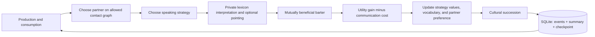

# Lingua Franca

A reproducible artificial-society laboratory for studying how trade incentives,
cultural attitudes, isolation, and reinforcement learning interact with shared vocabulary.

**Current architecture: Python + SQLite. No Redpanda, Kubernetes, Docker, GPU, API key,
or LLM is required.** Each run is a single process. Geographic separation is an explicit
contact graph, checked against the recorded encounters.

These are experiments on synthetic agents. They do not establish facts about human
nature, actual cultures, or the history of Romance languages.

## What agents do

Six communities produce and consume grain, water, timber, ore, cloth, and medicine.
Each agent attempts two one-for-one barters per round. Both traders must benefit from
the exchange; communication effort is charged separately to the buyer. Regional
specialization and a rotating drought create reasons to exchange goods.

Agents request goods using learned words. Listeners interpret those words from their
own vocabulary. Pointing can repair misunderstandings. Agents cannot read each other's
private dictionaries. Four speaking strategies compete:

- **Conventional:** use a word from the speaker's own lexicon.
- **Accommodate:** use a regional word previously heard in a successful encounter.
- **Clarify:** pay for explicit pointing to communicate the request.
- **Innovate:** coin a word that may or may not be learned by the listener.

Each agent uses a contextual bandit with separate local and remote strategy values.
Reward is the buyer's inventory-utility gain minus communication effort. Vocabulary
learning and trading-partner preferences are separate from strategy learning. Attitudes
toward change affect learning, repair, and the effort of using unfamiliar conventions.
Cultural succession replaces language and strategy knowledge through three local tutors
while retaining physical resources. There is no automatic reward for novelty.



## Run a quick experiment

Python 3.11+; the simulator has no third-party dependencies.

```sh
python -m galapagos.society --output runs/example --rounds 1000 --population 20 --seed 476
```

Re-running the identical command resumes from the last committed round. Changing the
model source or configuration causes a mismatch error instead of silently mixing models.
Stop with Ctrl+C; SQLite commits each round's events, summary, and checkpoint atomically.
Do not run two writers against the same output directory.

## Run the complete study

```sh
python -m pip install -e '.[analysis]'
python -m galapagos.society_study --output runs/full-study
```

Nine sequential runs: three seeds (476, 911, 2026), three conditions, 24,000 rounds each,
120 agents, and **51,840,000 encounters** in total. Conditions compare adaptive strategies,
uniform-random strategies, and adaptive strategies with uniform effective cultural
openness. Fixed strategies still permit vocabulary learning and partner preferences.
The study produces an audited report and plots under `runs/full-study/report/`.
Raw event ledgers stay local; plan for several GB of disk space.

The contact timeline is connected (20%), fragmented (45%), sparse trade routes (25%),
mass contact (8%), and dense contact (2%). During fragmentation, two regions are completely
isolated and two pairs retain sparse links. Rounds are not historical years.

On the original workstation, the authorized full run uses a user service capped at
one CPU core and 2 GiB of memory. `tools/societyctl status`, `logs`, `stop`, and `start`
inspect, stop, or resume it. The CPU cap applies to the whole service, including analysis.
A source/configuration-locked checkpoint supports recovery after interruption. The
transient service does not automatically restart after a reboot; use `start` to resume.

## Results and inspection

The full-study report is generated **after every run finishes**:

- [Full report](docs/results/lingua-franca/report.md)
- [Machine-readable metrics and audit checks](docs/results/lingua-franca/metrics.json)
- [Individual-seed trajectories](docs/results/lingua-franca/trajectories.png)

Until completion, those files may not exist. Status is in the study's `study.json` and
each run's `status.json`; the SQLite checkpoint is authoritative between status updates.
The report publishes all seeds, economic and linguistic outcomes, paired comparisons,
null or unfavorable results, and implementation limitations. It checks event completeness,
resource balance, legal contact pairs, and consistency between summaries and events.

Example read-only ledger query:

```sh
sqlite3 -readonly runs/example/ledger.sqlite \
  'SELECT strategy,count(*),avg(traded),avg(reward) FROM events GROUP BY strategy;'
```

For custom analyses, `events` contains every request, strategy, first-pass success,
repair use, grounded interpretation, trade result, reward, and each trader's utility gain.
`first_success` requires stock availability as well as comprehension. `repair_used`
includes explicit clarification even when the requested good is unavailable; `grounded`
records successful interpretation with stock. Neither is a pure language proficiency test.

## Validation

```sh
python -m unittest discover -s tests
```

Tests cover resource conservation, trade incentives, unknown-word interpretation,
contact restrictions, strategy learning, transactional rollback, and deterministic restart,
as well as the earlier simulator's regression tests.

## Scope and next experiments

The reinforcement mechanism is immediate-reward bandit learning, not deep RL or a
language model. Agents use single-word requests and shared nonlinguistic concepts.
There is no grammar, migration, market pricing, mortality, or empirical calibration.
Three seeds are exploratory evidence about this program, not a universal conclusion.
Useful next controls include always-conventional strategies, no-trade conditions,
separate attitude interventions, and alternative production and tutor rules. LLM-based
speech can later be introduced behind the same task and ledger, with explicit cost limits.

## Earlier Galapagos experiments

The original source, deployment manifests, and reports are retained for provenance.
They are legacy experiments; the current commands above never start a broker or cluster.
[Earlier project documentation](docs/legacy-galapagos.md) describes those historical
versions. [Previous historical-comparison results](docs/results/historical-comparison/metrics.json)
are separate from this study. The package namespace remains `galapagos` to preserve imports.
