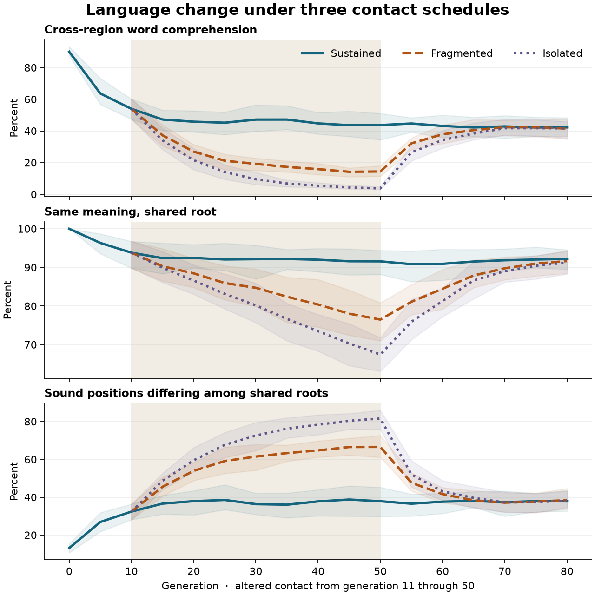

# What survives a break in contact?

After 40 generations of fragmented contact, **76.5% of same-meaning word pairs across regions still shared a root**, yet listeners recognized only **14.4%** of words from another region. In matched worlds with sustained contact, those figures were 91.6% and 43.7%. Pronunciations had diverged even where the root survived.

All three branches began at the same saved state for each of 24 independent seeds. Every community received the same number of word transmissions. The experiment changed who could teach whom. [Design and primary outcome](design.md)



Lines show the mean across seeds. Ribbons span the 10th to 90th percentiles across worlds. The shaded period covers the contact intervention. All three branches use the same contact schedule again after generation 50.

| Contact history | Word recognition at end of intervention | Same-meaning words sharing a root | Sound positions differing among shared roots | Word recognition after 30 generations of reconnection |
|---|---:|---:|---:|---:|
| Sustained | 43.7% | 91.6% | 37.8% | 42.2% |
| Fragmented | 14.4% | 76.5% | 66.6% | 41.5% |
| Isolated | 3.7% | 67.4% | 81.6% | 41.6% |

The primary comparison was fragmented minus sustained word recognition at generation 50.
The paired mean was **−29.3 percentage points** (95% paired bootstrap interval −31.4 to −27.1).
All 24 seed pairs showed lower recognition under fragmentation, and the entire interval exceeded the prespecified five-point benchmark in magnitude. Each branch had 230,400 transmissions during the intervention. The observed cross-region shares were 25.05% under sustained contact, 5.01% under fragmentation, and zero under isolation.

## What the Roman analogy can explain

This pilot supplies an example of how communities can keep related words and lose the ability to recognize them across regions. It also exposes a difficulty with explaining lasting divergence through contact alone. Five generations after full contact resumed, word recognition in the fragmented branch had already risen to 32.2%. After 30 generations its gap from the sustained control had narrowed to 0.75 percentage points.

Two features matter before interpreting this as a history of Romance. First, recognition fell from 90.0% to 53.9% during the ten common generations *before* fragmentation. The assumed sound changes and a listener that matches words by sound position make comprehension fragile even under sustained contact. Second, each region has only one conventional word per meaning. Copying a foreign word gives it immediate regional adoption. Real communities can understand a neighbor’s form while continuing to use their own. The pilot cannot distinguish passive understanding from adoption.

The recognition task gives the listener 40 possible meanings. Chance performance is 2.5%. Each direction of every region pair is scored separately. A shared root can spread through either descent or borrowing. The sound-distance calculation includes only pairs that still share a root, so the set of words in that comparison changes over time. None of the rates were fitted to historical Romance speech or to measured intelligibility in China or India.

The next historical test would separate recognition from adoption and check rates of sound change and root retention against independent linguistic data before comparing alternative contact histories. The uncertainty interval here measures variation across synthetic worlds with fixed rules.

## Reproduction

From the project root, install the analysis extra and run the pilot. The SQLite ledger records every directed regional measurement and each generation’s contact counts. A completed seed is committed in one transaction and can be reused on restart.

```sh
python -m pip install -e '.[analysis]'
python -m lingua_franca.contact --ledger runs/contact-pilot/ledger.sqlite --output runs/contact-pilot/report
```

The command recreates the figure, per-seed trajectories, and numeric summary. The design and this interpretation are accompanying documents. [Per-seed measurements](trajectories.csv) · [Summary and contact counts](summary.json)
