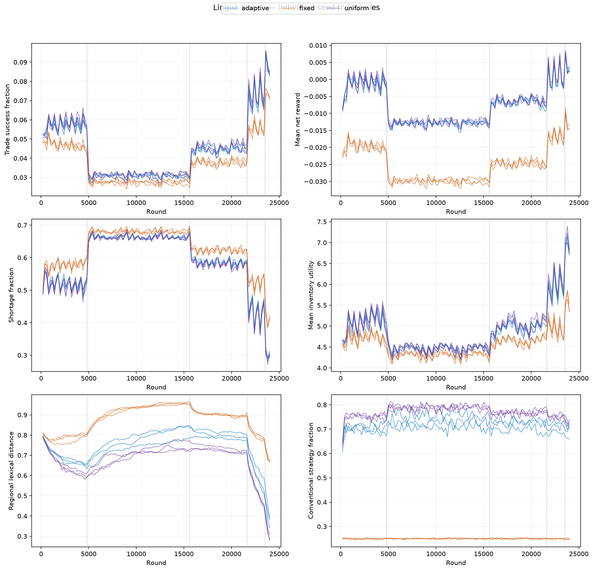

# Trade and communication in Lingua Franca

9 runs covered 51,840,000 encounters. Each run followed six communities of 20 agents for 24,000 rounds. The matched seeds were 476, 911, 2026.

**All ledger integrity checks passed.**

## What changed when agents learned a speaking strategy?

Every agent can learn words and update its preferences for trading partners. The adaptive condition also learns which speaking strategies pay off. The fixed condition samples the four strategies uniformly at random throughout the run. The uniform condition learns strategies with effective openness set to 0.50 for everyone.

| Condition | Encounters ending in trade | Mean buyer reward | Mean shortage | Final lexical distance |
|---|---:|---:|---:|---:|
| adaptive | 4.40% | -0.00759 | 58.96% | 0.3715 |
| fixed | 3.72% | -0.02517 | 62.66% | 0.6687 |
| uniform | 4.47% | -0.00736 | 58.59% | 0.2900 |

Each row is a mean across seeds. Buyer reward is inventory utility gained minus communication effort. Shortage is the proportion of agent–good inventories below half a unit. Lexical distance measures how differently regions distribute word use for the same good, from 0 (identical) to 1 (disjoint).

### Differences within matched seeds

Each difference below subtracts the comparison condition from the adaptive condition at the same seed. Trade and shortage differences are in percentage points (pp).

| Comparison | Seed | Trade (pp) | Buyer reward | Shortage (pp) | Final lexical distance |
|---|---:|---:|---:|---:|
| Adaptive minus fixed | 476 | +0.691 | +0.01810 | -3.823 | -0.2911 |
| Adaptive minus fixed | 911 | +0.662 | +0.01761 | -3.692 | -0.3259 |
| Adaptive minus fixed | 2026 | +0.689 | +0.01703 | -3.584 | -0.2746 |
| Adaptive minus uniform | 476 | -0.058 | +0.00021 | +0.281 | +0.0721 |
| Adaptive minus uniform | 911 | -0.071 | -0.00014 | +0.384 | +0.0611 |
| Adaptive minus uniform | 2026 | -0.091 | -0.00077 | +0.465 | +0.1112 |

Net reward can improve when agents spend less effort communicating. The trade and shortage columns show whether an improvement also coincided with more exchanges and better-stocked inventories. Openness affects repair, word learning, and effort together, so this design cannot isolate their individual effects.

## Contact over time

The schedule starts with all regions connected, separates them into pairs or isolated regions, opens a chain of trade routes, then reconnects all regions with increasing frequency. Time, accumulated learning, resource availability, and turnover also change across phases. These phase comparisons are descriptive.

| Condition | Phase | Trade | First-pass success | Mean reward | Shortage | Encounters across regions |
|---|---|---:|---:|---:|---:|---:|
| adaptive | connected | 5.68% | 18.61% | -0.00157 | 52.06% | 12.01% |
| adaptive | fragmented | 3.08% | 9.41% | -0.01289 | 66.38% | 0.67% |
| adaptive | trade routes | 4.47% | 14.50% | -0.00653 | 58.59% | 8.00% |
| adaptive | mass contact | 7.25% | 27.80% | 0.00109 | 43.16% | 19.95% |
| adaptive | dense contact | 8.84% | 36.38% | 0.00335 | 29.03% | 44.96% |
| fixed | connected | 4.70% | 8.37% | -0.01977 | 57.53% | 12.01% |
| fixed | fragmented | 2.75% | 4.80% | -0.02990 | 68.03% | 0.67% |
| fixed | trade routes | 3.78% | 6.22% | -0.02472 | 62.28% | 8.00% |
| fixed | mass contact | 5.56% | 7.52% | -0.01664 | 52.42% | 19.95% |
| fixed | dense contact | 7.63% | 9.58% | -0.01244 | 38.89% | 44.96% |
| uniform | connected | 5.78% | 19.50% | -0.00116 | 51.55% | 12.01% |
| uniform | fragmented | 3.12% | 9.80% | -0.01271 | 66.23% | 0.67% |
| uniform | trade routes | 4.55% | 15.58% | -0.00644 | 58.13% | 8.00% |
| uniform | mass contact | 7.44% | 30.13% | 0.00174 | 42.19% | 19.95% |
| uniform | dense contact | 8.90% | 37.98% | 0.00335 | 28.25% | 44.96% |

First-pass success requires both recognition of the requested word and stock of the requested good. A separate comprehension task would be needed to measure mutual intelligibility.

Each line follows one seed. Dotted lines mark contact-phase boundaries.

## Ledger audit

The audit checks SQLite integrity, run configuration, completed rounds, encounter counts, checkpoint completion, legal contacts, and resource conservation. It also compares trades, rewards, and utility gains against the round summaries.

| Condition | Seed | Encounters | Checks |
|---|---:|---:|---|
| adaptive | 476 | 5,760,000 | Pass |
| fixed | 476 | 5,760,000 | Pass |
| uniform | 476 | 5,760,000 | Pass |
| adaptive | 911 | 5,760,000 | Pass |
| fixed | 911 | 5,760,000 | Pass |
| uniform | 911 | 5,760,000 | Pass |
| adaptive | 2026 | 5,760,000 | Pass |
| fixed | 2026 | 5,760,000 | Pass |
| uniform | 2026 | 5,760,000 | Pass |

The metrics file includes each run’s model fingerprint, audit checks, strategy shares, dominant regional words, final regional utility and openness, and trajectories in blocks of up to 200 rounds. [Download metrics](metrics.json)
