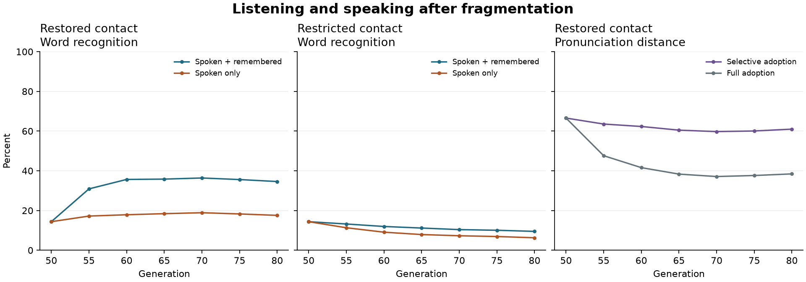

# Understanding neighbors while keeping a local pronunciation

After 30 generations of renewed contact, communities that selectively adopted
foreign pronunciations recognized **34.6%** of other regions’ words. Scoring the
same listeners on the same utterances with their spoken vocabulary alone gave
**17.6%**. Remembering words heard from neighbors accounted for a 17.0 percentage
point gain without changing a single spoken form in that comparison.

The 24 worlds each started from the fragmented state of the first pilot at
generation 50, with 14.4% recognition. Every community received the same number
of tutor exposures. Restored contact spread a quarter of those exposures across
all other regions. Continued fragmentation gave 5% of exposures to immediate
neighbors. Selective adoption gave each foreign exposure a 25% chance to supply
the next local spoken form. Listeners could remember an exposure regardless
of whether it was adopted. [Design recorded before the run](design.md)



Each line averages 24 matched seeds. The two recognition panels use selective
adoption. The final panel compares adoption rules under restored contact.

## All four worlds at generation 80

| Contact | Adoption | Recognition using spoken forms | Recognition including remembered forms | Pronunciation distance among shared roots | Same-meaning words sharing a root |
|---|---|---:|---:|---:|---:|
| Restored | Full | 41.5% | 51.7% | 38.4% | 91.6% |
| Restored | Selective | 17.6% | 34.6% | 61.0% | 75.9% |
| Restricted | Full | 13.7% | 14.6% | 66.0% | 69.5% |
| Restricted | Selective | 6.3% | 9.5% | 77.5% | 62.7% |

The **primary comparison** holds selective adoption and memory fixed. Restoring
contact improved recognition by **25.1 percentage points** relative to continued
fragmentation (95% paired bootstrap interval 24.1 to 26.1). All 24 seed pairs
showed that advantage. Measured against the common starting state, recognition
rose 20.2 points in the restored branch and fell 4.9 points under continuing
restrictions.

Two comparisons explain the result. Access to remembered pronunciations added
17.0 points under restored, selective contact (95% interval 16.3 to 17.7).
Meanwhile, selective adoption preserved 22.5 points more pronunciation distance
than full adoption under the same contact schedule (95% interval 21.0 to 24.0,
calculated before rounding the endpoints). All three comparisons cleared the
five-point benchmark in the design.

## Interpretation

Regions could understand more of one another’s speech while retaining much of
their earlier pronunciation difference. At the split, 66.6% of sound positions
differed among same-meaning words that shared a root. After reconnection and
selective adoption, 61.0% still differed. The shared-root proportion moved from
76.5% to 75.9%. The sound comparison includes only words that share a root at
the time of each measurement. Both descent and borrowing can produce a root match.

Recognition still covered only about a third of the 40-meaning vocabulary.
Full adoption produced the highest recognition and the lowest remaining distance
under reconnection. The listener in this model gets the correct meaning from
context during learning and can remember up to three recent foreign examples
per meaning. The reported recognition task provides no context or feedback.
The study assumes selective adoption and tests its consequences. It does not
establish how often a historical speaker adopted a neighbor’s pronunciation or
understood an unfamiliar word. The intervals describe variation across simulated
worlds under fixed rules.

## Reproduction

From the project root, run the following commands.

```sh
python -m pip install -e '.[analysis]'
python -m lingua_franca.receptive --output runs/receptive-vocabulary
```

The output contains the figure, the source fingerprints, the paired contrasts,
and all per-seed measurements at five-generation intervals. Exposure and copy
counts in the CSV are cumulative since the split. A copy counts selection of a
foreign tutor for production, even when both tutors use the same form or the
learner subsequently coins a word. [Trajectories and counts](trajectories.csv) ·
[Paired estimates](summary.json)
