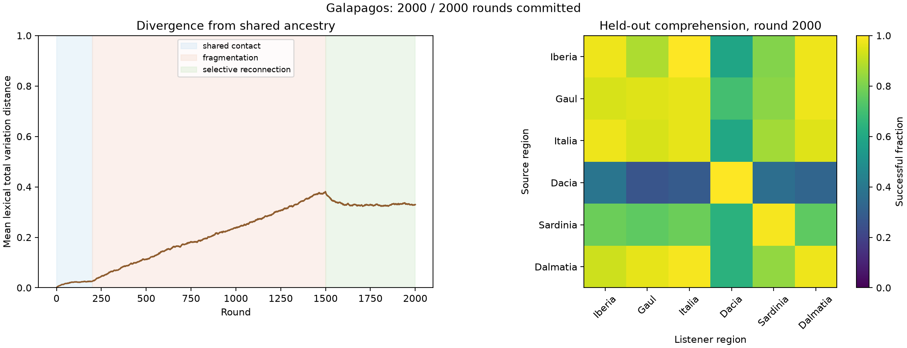

# Roman-collapse-inspired regional experiment

Latest committed round: **2000 / 2000**.
Phase: **selective_reconnection**. Population: **360**.

These are artificial languages over shared concepts, not reconstructed Latin or historical Romance varieties.

| Region | Speakers | Most frequent form for water | Preferred construction |
| --- | ---: | --- | --- |
| Iberia | 41 | nara | verb_object |
| Gaul | 76 | nara | verb_object |
| Italia | 76 | nara | verb_object |
| Dacia | 63 | nere | verb_object |
| Sardinia | 58 | nara | verb_object |
| Dalmatia | 46 | nara | verb_object |

## Observations

Mean lexical distance: 0.3295 (0 = identical production distributions, 1 = disjoint).

Held-out comprehension is tested centrally without creating agent contact or learning. It is not an interaction across a closed network boundary.

